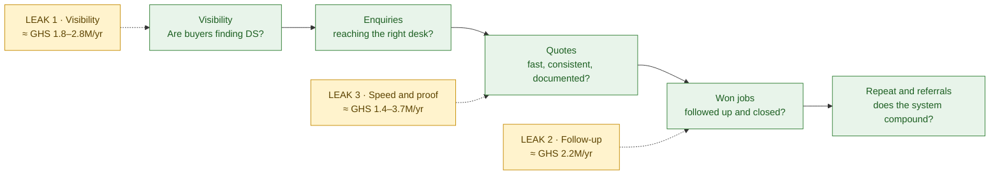
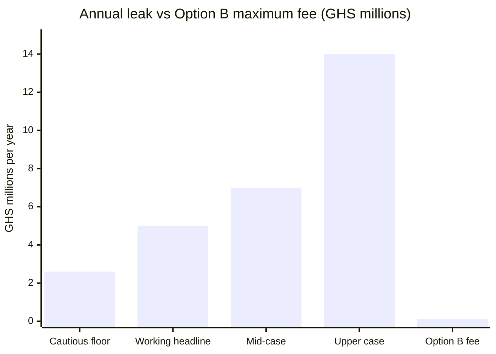
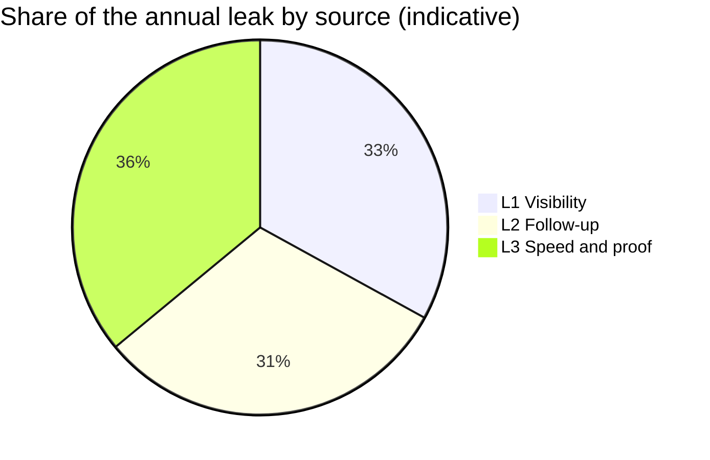
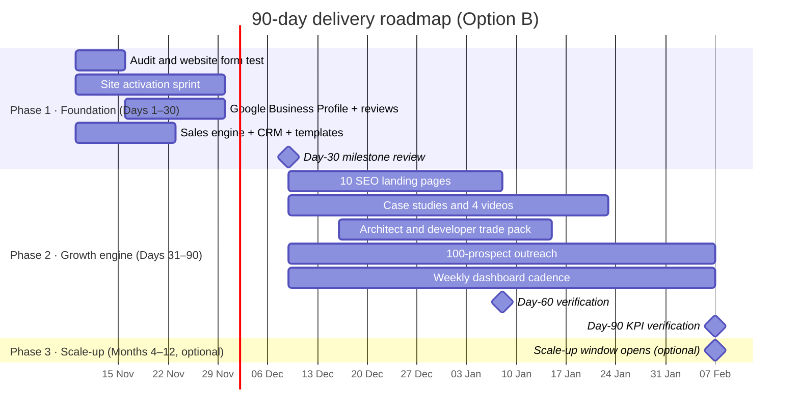
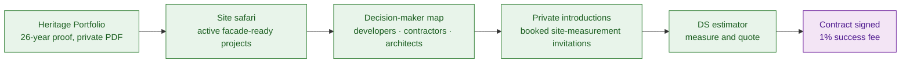
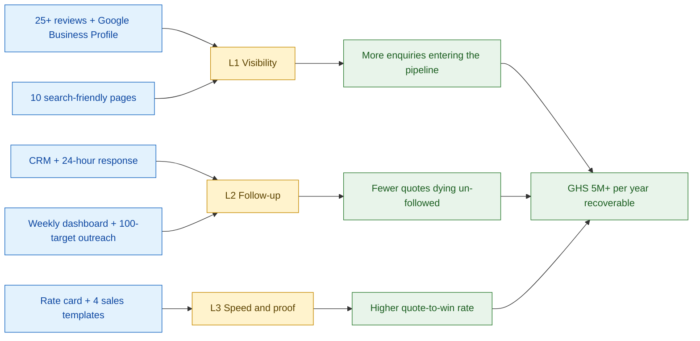
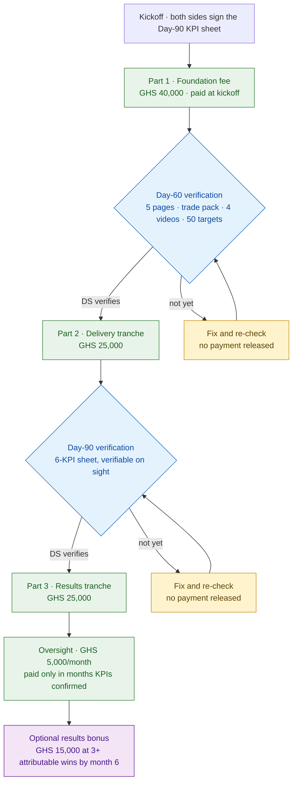

# PROPOSAL — The DS Growth & Sales System
**From "well-known but invisible" to Ghana's default glazing choice**

**To:** Management, DS Construction Limited  
**Prepared by:** **Gideon B. Abochie** — BArch (KNUST) Architect · Founder, Gabochie Marketing · Principal, Gabochie Design / Gabochie Corp (Built-Environment Intelligence)  
**Contact:** admin@gabochie.com · +233 26 824 8970 · mkt.gabochie.com · P.O. Box SK 2125, Sakumono, Tema  
**Date:** 6 November 2026  
**Validity:** 30 days — valid until 6 December 2026

---

## 1. One-paragraph version

> My recent analysis of Ghana's aluminium-glazing market produced one headline finding: **DS Construction's advantages are real, proven and hard to copy — 26 years of institutional work, an in-house factory, a nationwide fleet — yet they remain difficult for buyers to find, verify and reach.** Your team has just taken the right first step: the new website is a clean, modern shopfront — credit to whoever built it. What it does not yet do is get found (search visibility), prove trust (visible reviews and client stories), or capture and manage the enquiries it attracts (a working enquiry pipeline). Those three gaps are this engagement's entire purpose: **within 90 days**, every enquiry answered within 24 hours, 25+ verified public reviews, visible standing on Google Maps for "aluminium windows Accra," and a pipeline handled the same way every day. The terms are fixed-fee and milestone-paid, with a written minimum-performance commitment. And because DS has asked to keep a deliberately low public profile, this proposal also includes a fully private, legacy-led route — **Option D** — that avoids public advertising altogether and places your 26-year heritage directly in front of the developers, contractors and architects who buy glass.

---

## 2. What's at stake — and why the timing matters

The analysis found real strength: a generation of earned trust on Ghana's project sites, plus a freshly rebuilt website. It also found that trust is under-represented where buyers actually search and verify. Gently put:

| Where DS stands today | The opportunity in the market around you |
|---|---|
| The new website looks the part, but carries limited search visibility, no visitor tracking, and (to be tested) a possibly silent enquiry form | Institutional buyers begin with online shortlisting every time — visibility and proof decide who is even considered |
| Happy clients have praised you privately, but little of this praise is visible publicly | New buyers verify trust online first; your blue-chip history deserves to be seen and verified |
| Enquiries and quotes arrive by phone/WhatsApp and rest on memory and goodwill | 40–60% of quote opportunities across the industry are never followed up — a simple system fixes this |
| Building-material demand is soft this year (cement sales −10.3% in 2026) | In a cautious market, the visibly fastest and best-documented names win the shortlists |
| Competitors like K3 now court your institutional segment with strong corporate presentation | The audit found no competitor matching your 26 years of institutional proof — that story is yours to tell |

**The good news:** Ghana's construction output grows +5.2% in 2026 and about +5.1% annually to 2030. The market is there — the engagement's purpose is simply to make you the most visible, most verifiable and fastest-to-quote participant in it.

### The funnel — where value leaks

*L1 suppresses how many enquiries arrive; L2 and L3 quietly kill the quotes that do. Each Day-90 KPI repairs one leak — which is why the fee is tied to them, not to activity.*

### The money view — what the condition is worth (indicative, to be calibrated)

Built as a model over three leaks — enquiries not arriving (low visibility), quotes not followed up (our industry loses 40–60%), and quotes that lose on paperwork/speed rather than product — the arithmetic suggests DS is plausibly leaving **GHS 5M+ per year** unconverted, even under cautious assumptions (a range of GHS 2.6M–14M/yr depending on your real quote volumes and average deal values, which we will calibrate with your records in Week 1 — the model then becomes a revenue plan, not a sales pitch). Against that, this engagement's maximum cost (GHS 105,000 in Option B) is about **2% of the leak** — and even at the most cautious corner of the range, recovering **one** additional mid-size institutional job repays the entire engagement.

#### The money view at a glance

| Leak | Annual value (mid) | Indicative range | Repaired by |
|---|---|---|---|
| L1 · Visibility | ≈ GHS 2.3M | GHS 0.9–5.0M | Google reviews, Business Profile, 10 search pages |
| L2 · Follow-up | ≈ GHS 2.2M | GHS 1.0–3.4M | CRM, 24-hour response, weekly dashboard |
| L3 · Speed & proof | ≈ GHS 2.5M | GHS 0.7–5.6M | Rate card, ≤3-day quotes, warranties and case studies |
| **Total (mid-case)** | **≈ GHS 7M** | **GHS 2.6–14M** | **The Day-90 KPI sheet** |

*Mid-case = the sum of the source mid-points above; the "GHS 5M+" working headline used in the text is deliberately more conservative. Source shares hold across the range. Option B's GHS 105,000 maximum is ~2% of even the cautious floor — a sliver in the chart above.*

---

## 3. The Offer — three phases, one integrated system

### Phase 1 — THE FOUNDATION (Days 1–30) · "Secure the base"
- Full **marketing & sales audit** (already researched — delivered as findings report + a test of whether the new website's enquiry form actually delivers)
- **Site activation sprint, working with your web developer:** per-page search titles & descriptions, WhatsApp/Instagram link previews, enquiry-form wiring and testing, visitor tracking installed, dead links corrected, client logos and testimonials restored — we supply the briefs and copy; your developer publishes (or we can implement directly if preferred)
- **Google Business Profile**: rebuilt, verified, 20+ location-tagged photos — starts the review engine
- Brand kit: one positioning ("Ghana's most experienced aluminium glazing factory — trusted by institutions for 25+ years"), one company statement, refreshed social profiles
- **Sales engine week 1:** single enquiry intake + WhatsApp auto-reply flow + free CRM (customer records) + 24-hour quote-response standard + a simple three-touch follow-up routine
- 4 templates: rate card, survey form, quote/BOQ (bill of quantities), deposit-and-milestones contract
- Milestone checks: form test passed · leads logged same day · quotes sent within 48 hours for standard items · first 5 reviews live

### Phase 2 — THE GROWTH ENGINE (Days 31–90) · "Make enquiry a habit"
- 10 SEO landing pages targeting the searches Ghanaians actually run ("aluminium windows Accra", "curtain wall contractor Ghana", "Alucobond cladding Accra"…)
- 2 flagship case studies (Ashesi / University of Ghana standard) + 4 process/testimonial videos
- **Architect & Developer trade pack**: datasheets, warranty document, CAD/BIM on request
- Published package offers and written guarantees: Estate Bundle · Fit-Out Package · Home Upgrade — each opening with a free on-site survey as the invitation
- 100-prospect outreach engine (architects, QS firms, developers) with monthly cadence — MD-supported
- Pipeline cadence teams trained; **weekly dashboard live** (response time · quotes · wins · loss reasons)
- Milestone checks: 10 pages live · 25+ reviews · 100 prospects reached · weekly dashboard operational

### Phase 3 — THE SCALE-UP (Months 4–12, optional retainer)
- Paid advertising on Facebook and Google — shown to people already searching for, or who have visited, work of this kind — once quoting capacity is proven
- 5 developer partnerships pursued ("Windows-as-Standard" offers), + Togo/regional showcase page
- Monthly performance reviews; every cedi of spend judged by what it returns; step-by-step written procedures so the system keeps running without me
- Marketing-coordinator onboarding + handover documentation

### The 90-day roadmap at a glance

*Dates assume a kickoff within five working days of signature, as set out in §9. Phase 3 runs beyond Day 90 and is shown only as an opening milestone.*

---

## 4. What You Can Expect (crafted from the audit math)

| Area | Today | After 90 days |
|---|---|---|
| Time to respond to an enquiry | Not yet tracked (often days) | **Within 24 hours — target 4 hours** |
| Visible public proof | Praise held privately, no online reviews yet | **25+ verified reviews + client logo wall** |
| Google Maps: "aluminium windows Accra" | Not currently visible | **Top-3 map ambition, checked weekly** |
| Website | New site (good), but content still dates from 2022 | Foundation kept & activated: search titles, tracking, restored social proof, working enquiry form |
| Enquiry pipeline | Held in memory | **Daily stand-up + one weekly 5-line dashboard, ≤ 24-hour response** |
| Quote capability | Case by case | **Rate card + ≤ 3-day custom + 24–48-hour standard quotes** |

Longer-term projections are made **only after** Phase-2 data — I don't make projections I cannot stand behind; measured numbers first, then targets built on them.

---

## 5. Investment — four engagement options, tied to agreed results

All advertising and software budgets are DS's own operating costs (a transparent schedule is provided during the engagement). For Options B and C, **more than half of the project total is only paid when you accept the agreed results**; Option D is paid only against verified introductions and closed contracts.

Options A–C build the public-facing visibility and sales system. **Option D is different — and, for DS's stated priorities, it is the one I recommend:** a 100% private, legacy-led B2B partnership that runs no public branded advertising, no sponsored posts and no ad tracking, and instead places DS's 26-year record directly in front of the decision-makers who control glass and facade spend.

| Component | **Option A — Strategy Sprint** | **Option B — Results Partnership** (full digital system) | **Option C — Scaled Partner** |
|---|---|---|---|
| Scope | Strategy + documentation only | Phases 1 + 2 executed with you, plus oversight to month 6 | Option B + paid-ads management, developer partnerships, quarterly reviews to month 12 |
| **Part 1 — Foundation fee** (paid at kickoff: audit, brand kit, enquiry system build, templates, training — work delivered regardless of market outcomes) | GHS 25,000 | **GHS 40,000** | **GHS 40,000** |
| **Part 2 — Delivery tranche** (day 60, released when you verify: 5 search-friendly pages live · trade pack ready · 4 videos published · 50 outreach targets contacted) | GHS 20,000 | **GHS 25,000** | **GHS 25,000** |
| **Part 3 — Results tranche** (day 90, released only when you verify the KPI sheet below) | — (next steps include a paid follow-through at fixed GHS 5,000/month) | **GHS 25,000** | **GHS 25,000** |
| **Ongoing oversight** (months 4–6 for B; 4–12 for C, paid only in months you confirm the monthly KPIs) | optional GHS 5,000/month | GHS 5,000/month × 3 | GHS 5,000/month × 9 |
| **Results bonus (optional)** | — | GHS 15,000 if ≥3 new won contracts are documentably sourced from the new system by month 6 (or 2.5% of attributable winning value, whichever is lower) | Same |
| **Maximum total** | GHS 45,000 + optional | **GHS 105,000 + optional bonus** | **GHS 145,000 + bonus if bonus triggered earlier** |
| In-house effort needed | ~30 min/day from MD | ~45 min/day + one coordinator (can be existing staff, can be recruited with my brief) | Same |

### Option D — THE PRIVATE GROWTH PARTNERSHIP · recommended for DS

> **For a 26-year firm with tier-1 capacity, the fastest growth is not louder advertising — it is quieter, higher-value introductions.**

Option D is a private, account-based business-development partnership. It runs **no public branded advertising, no sponsored posts, no Meta pixel and no public lead forms in DS's name.** Instead, it turns the 26-year heritage into a private credential and places it directly in front of the people who decide who installs the glass: estate developers, main contractors, procurement heads, architects and quantity surveyors. The public sees nothing; DS's pipeline fills privately.

**What is delivered**

| # | Deliverable | What DS receives |
|---|---|---|
| 1 | **Heritage Portfolio** | A premium, private PDF — *"26 Years of Engineering Glass & Steel: Selected Structural Glazing Case Studies in Ghana"* — built from DS's iconic projects. Never published publicly; used only in one-to-one outreach. |
| 2 | **Decision-maker map** | A living target list of 30+ architectural/QS firms and 20+ active main contractors across Greater Accra and Ashanti, plus weekly mapping of active sites at the facade-ready stage. |
| 3 | **Private introductions** | Direct, named introductions to verified decision-makers (Project Manager, Site Engineer, Owner or Lead Architect) of active projects — booked site-measurement and quote invitations. |
| 4 | **Guaranteed floor** | Path A guarantees **3–5 qualified site-measurement invitations per month**. If we fall short, the following month is at no charge. |
| 5 | **Smooth hand-off** | DS's estimator receives the introduction and owns measurement and pricing. We do not interfere with DS's client relationship. |
| 6 | **Confidentiality** | No public footprint, no ad accounts, no audience uploads, no branded campaigns. Progress is reported privately to management — keeping DS off the radar of automated revenue tracking. |

**Two ways to run it — choose the one that fits how DS wants to grow**

| | **Path A — Done-For-You** | **Path B — In-House Engine Build** |
|---|---|---|
| **Best for** | Immediate high-ticket pipeline without adding payroll | Building a permanent internal business-development team |
| **What we do** | Build the Heritage Portfolio, map the sites and decision-makers, make the private introductions and secure the site-measurement invitations | Design the scouting framework, write the scripts, build the tracking database, train DS's nominated staff and co-pilot their first field loops |
| **What DS does** | Sends the estimator to measure and quote | Runs the system with its own staff after training; we audit and optimise |
| **Setup fee** | **GHS 4,000** (one-time, Month 1) | **GHS 12,000–15,000** (split across Months 1–2) |
| **Monthly fee** | **GHS 5,500 / month** | **GHS 3,000 / month** oversight from Month 3 |
| **Success fee** | **1% of contract value** on any introduced project that signs and pays its mobilisation deposit | **None** — DS keeps 100% of the upside it wins with its own team |
| **Guarantee** | 3–5 qualified site-measurement invitations/month, or the next month is free | Staff certified on the scouting system; 60-day co-pilot included |

**What counts as a qualified invitation** *(written into the agreement)*: a confirmed meeting or site visit with a named decision-maker — Project Manager, Site Engineer, Owner or Lead Architect — of an active project in Greater Accra or Ashanti; for a service DS actually provides; where the contact confirms they requested the quote or inspection. No vague counts, no time-wasters.

**The proof-first close.** Before DS pays anything, give us photographs of three of your most iconic completed buildings. We will build a sample Heritage Portfolio in the new format at no cost. If it does not make 26 years of work look as strong as it is, there is nothing to discuss. If it does, we activate the private pipeline immediately — typically within seven working days.

**Why Option D is the recommended first move:** it is the only route that requires no advertising budget, creates no public tax footprint, targets contracts worth tens to hundreds of thousands of Ghana Cedis each, directly answers the "we could use our own staff" question through Path B, and puts DS's strongest asset — 26 years of proven, iconic work — in front of buyers at the exact moment they are choosing a facade partner. Timing matters: facade packages are specified ahead of the dry-season build window, so the firms that introduce themselves now are the ones written into the bill of quantities. Option D runs on its own, or can be layered with Option B if DS later wants the public visibility system as well.

*The Day-90 KPI sheet below applies to Options B and C (and Option A's optional follow-through). Option D is governed by its own one-page agreement: the qualified-invitation definition, the monthly guarantee and the success-fee trigger, as set out above.*

**The Day-90 KPI sheet (both parties sign at kickoff; each item verifiable on sight):**
| # | KPI | Verified by | Money lever it opens |
|---|---|---|---|
| 1 | 25+ approved, genuine client reviews on Google | Screenshot of live profile | More enquiries finding you (visibility) |
| 2 | 10 search-friendly webpages live & indexed | Live URLs | Same, per product line |
| 3 | Enquiry response standard working: logged leads, replies within 24 hours | CRM log + WhatsApp history | Fewer enquiries lost before quoting |
| 4 | Weekly 5-line dashboard running 4+ consecutive weeks | Meeting records | Pipeline discipline (the 40–60% follow-up leak) |
| 5 | Rate card + 4 sales templates in daily use | Documents + staff walkthrough | Faster quotes → better win rate |
| 6 | 100 outreach targets reached with records kept | Outreach log | Institutional repeat channel |

**How the six KPIs map to the money (the control panel):**

From month 4 onward, a second layer of **outcome KPIs** (leads by source, quotes, win rate, attributable won jobs) is reported monthly — that is where the GHS millions in §2's money view show up, measured against the plan we calibrate together with your real sales records in Week 1.

**A fair comparison:** Option B's maximum first-year professional cost (GHS 105,000) is **less than 15% of one average commercial curtain-wall contract** — and ~57% of it (Parts 2–3, GHS 50,000) is released only against your verification. If the system helps DS win just two additional mid-size institutional jobs, the engagement has repaid itself several times over — and the system keeps working for years.

**Option D is the lowest-risk entry of all:** Path A's first-year professional cost is **GHS 70,000 (GHS 4,000 setup + 12 × GHS 5,500) plus a 1% success fee only on contracts that actually sign and pay a mobilisation deposit** — under 8% of a single GHS 1,000,000 facade contract, with zero advertising spend. One privately introduced contract makes the entire year's retainer look trivial against the value it helped win.

### How payment follows verified results

*More than half the project total (Parts 2–3) sits behind your signature on a KPI sheet you can verify by opening a URL, counting reviews, or reading the CRM log.*

*Option D follows a simpler discipline: setup fee at kickoff, monthly fee paid only after the month's guaranteed introductions are verified, and the 1% success fee payable only when an introduced project signs and pays its mobilisation deposit. No introductions, no monthly fee — work continues against the same invoice until the guarantee is met.*

---

## 6. Trust architecture — why this proposal is safe to accept

Many clients hesitate to engage consultants for one honest reason: money walks in, results don't always walk out. This proposal is designed so that fear has no room:

1. **You keep the audit, whatever you decide.** Enclosed with this proposal is the Market & Digital Presence Audit — Summary: genuinely useful whether or not DS proceeds, and it cost you nothing.
2. **Payment follows acceptance, not effort.** The Foundation fee covers bricks you keep even if you stop there (audit, templates, systems built and trained). Parts 2 and 3 — more than half the project total — wait for your verified acceptance of the Day-60 and Day-90 KPI sheets.
3. **Results are pre-defined, not promised in adjectives.** At kickoff, both sides sign a one-page KPI sheet where every target is verifiable on sight — a review count you can see, pages you can open, a response time the records show. No interpretation, no debates at month 3.
4. **Why not 100% pay-on-results?** Being transparent: a pure contingency structure fails both sides — the consultant must cut corners to survive, and the client loses leverage over quality. The Foundation fee covers genuinely delivered, keepable assets; the larger share of the fee stays behind the KPI gate. That balance protects the quality of the work *and* your money.
5. **Full transparency and ownership:** every deliverable, password, asset and document is handed over in a shared drive as we go — everything belongs to DS at all times; there is no lock-in.
6. **A respectful exit:** 30 days' notice ends any ongoing oversight. If, at any monthly review, you are not satisfied, we part ways cleanly with all documentation in your hands.

## 7. Why Gideon B. Abochie — the profile fits this project better than an agency

**A KNUST-trained architect who understands exactly what your buyers see.** As a building-sector professional (BArch, Architecture, KNUST), I have sat where your architects, QS firms and corporate clients sit — reading spec documents, evaluating fabricators, judging whose technical materials look credible. Phase 2's architect trade pack, datasheets and BOQ templates will be built to *the professional standard specifiers expect*, not a marketer's approximation.

**A built-environment technology founder, not just a marketing voice.** As Principal of Gabochie Design / Gabochie Corp (digital infrastructure for architecture, construction and property — products include BuildCostGH construction-cost intelligence, GHBC and the AEC Agent API), I live daily inside the data of your exact industry. Your quote rate card, BOQ templates and pricing bands will be architected the way real AEC commercial documents work.

**A delivery partner who has already built and shipped these systems.** Through **Gabochie Marketing** (Lashibi, Tema) and the Gabochie Corp platform, live at **mkt.gabochie.com**, I have built and shipped the same systems Phase 1 installs for you — quote-automation templates, WhatsApp sales scripts, customer-record flows and revenue tools — already in use by 340+ Ghanaian SMEs. You're choosing a system built by someone who runs it themselves, delivered through an AI-amplified lean team, at a fraction of Accra agency retainers (US$8,000–15,000/month).

**A systems thinker for a family-owned business.** I am the author of *Architectural Thinking Vol. 1* and a body of systems-thinking work — the engagement you're considering is precisely about giving a founder-led company a system that runs without drama. It is the part of this work I enjoy most.

**Independence:** no equipment, material or contractor conflicts — my only interest is making DS win more of the right jobs.

## 8. What working together will require

1. A designated **Sales Coordinator** (a trusted existing staff member is ideal — trained by me in Week 1)
2. Permission to approach past clients for reviews and case studies (with an approval workflow that keeps you in control of what goes public)
3. About 45 minutes of the MD's time on execution days, plus the weekly pipeline review
4. Access to brand assets, social accounts, and ideally monthly revenue-by-source figures for honest ROI reporting
5. **Partnership with your existing web developer** (not a replacement): strategy, content and briefs come from this engagement; site changes are published by your developer — we bring the briefs, they bring the code. We will also confirm that all accounts — domain, hosting, WhatsApp line, social pages — are registered in the company's name rather than the vendor's, protecting DS's digital property.
6. Clear roles: we agree the rules of engagement together, with HR oversight from management on any staff scheduling.

**A note on the next generation:** if younger family members already help with your social pages, digital trends or IT, we will build on their work rather than replace it — their fluency is an asset this system is designed to multiply. Where useful, they are welcome in trainings alongside staff.

## 9. Next steps

1. We walk through this proposal together (30–45 min call or at your Nima office) and choose the route.
2. **If DS chooses Option D (recommended):** select Path A or Path B; for Path A, send photographs of three iconic projects so we can build the free sample Heritage Portfolio; sign the one-page private-pipeline agreement (qualified-invitation definition, monthly guarantee, 1% success-fee trigger); kickoff within **7 working days**. No advertising account, no public page and no ad spend is required.
3. **If DS chooses Option B or C:** the option selection is signed together with the one-page **Day-90 KPI sheet** (the same sheet shown in §5 — every target verifiable on sight); kickoff scheduled within 5 days. Day 3: enquiry intake + customer-record system goes live · Day 7: Google Business Profile + review campaign launched · Day 30: milestone review #1 (incl. proof the website enquiry form delivers).
4. **For Options B/C, sign the 30-Day Non-Negotiable Foundations checklist at kickoff** — the separate annex sets out the actions, owners, deadlines and direct costs (signage, photography, print, website fixes) that make the 90-day plan executable. For Option D, the equivalent is a short private setup checklist (portfolio assets, target list, outreach scripts) agreed at kickoff.

---

## Appendix — Plain-language glossary

- **CRM (customer-record system)** — a simple digital register of every customer, enquiry and quote; nothing is left in one person's memory
- **Google Business Profile** — the free Google listing that makes DS appear when someone searches "aluminium windows near me"
- **SEO / landing pages** — webpages written so Google shows them when Ghanaians search for specific products
- **BOQ** — bill of quantities: the item-by-item cost document professional buyers expect
- **Rate card** — a pre-agreed price list for standard products, so quotations are fast and consistent
- **KPI dashboard** — one weekly page of numbers: responses, quotes, wins, losses and reasons

---

### Supporting documents

*Shared after engagement begins: the detailed marketing audit, the phased 90-day implementation plan, the budget and tooling schedule, and the complete sales-system specification.*

***Enclosed with this proposal: "Market & Digital Presence Audit — Summary" — DS's copy to keep regardless of decision — and the "30-Day Non-Negotiable Foundations" checklist (actions, owners, deadlines, direct costs).***

*Consultant profiles: archinect.com/gabochie · mkt.gabochie.com.*

---

## Signature and acceptance

*Signing selects the chosen engagement option. For Options B and C it also accepts the Day-90 KPI sheet as the basis for Parts 2 and 3; for Option D it accepts the one-page private-pipeline agreement (Pathway A or B).*

**Selected option:** ______________________ (A / B / C / D)
**If Option D — selected pathway:** ______________________ (A · Done-For-You / B · In-House Engine Build)

| For DS Construction Limited | For the Consultant |
|---|---|
| Name: ______________________ | Name: Gideon B. Abochie |
| Title: ______________________ | Title: Principal, Gabochie Marketing |
| Signature: __________________ | Signature: __________________ |
| Date: ______________________ | Date: ______________________ |
