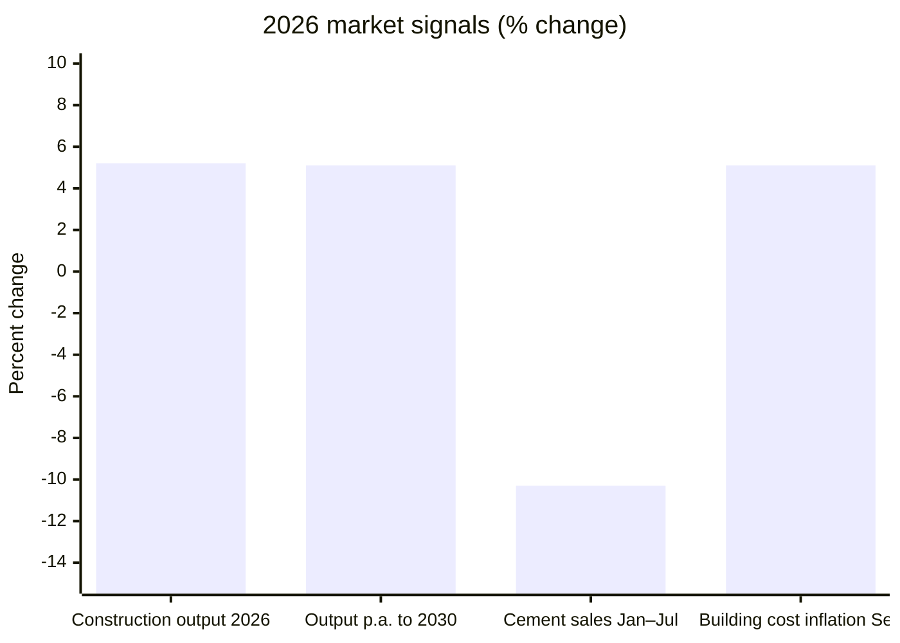
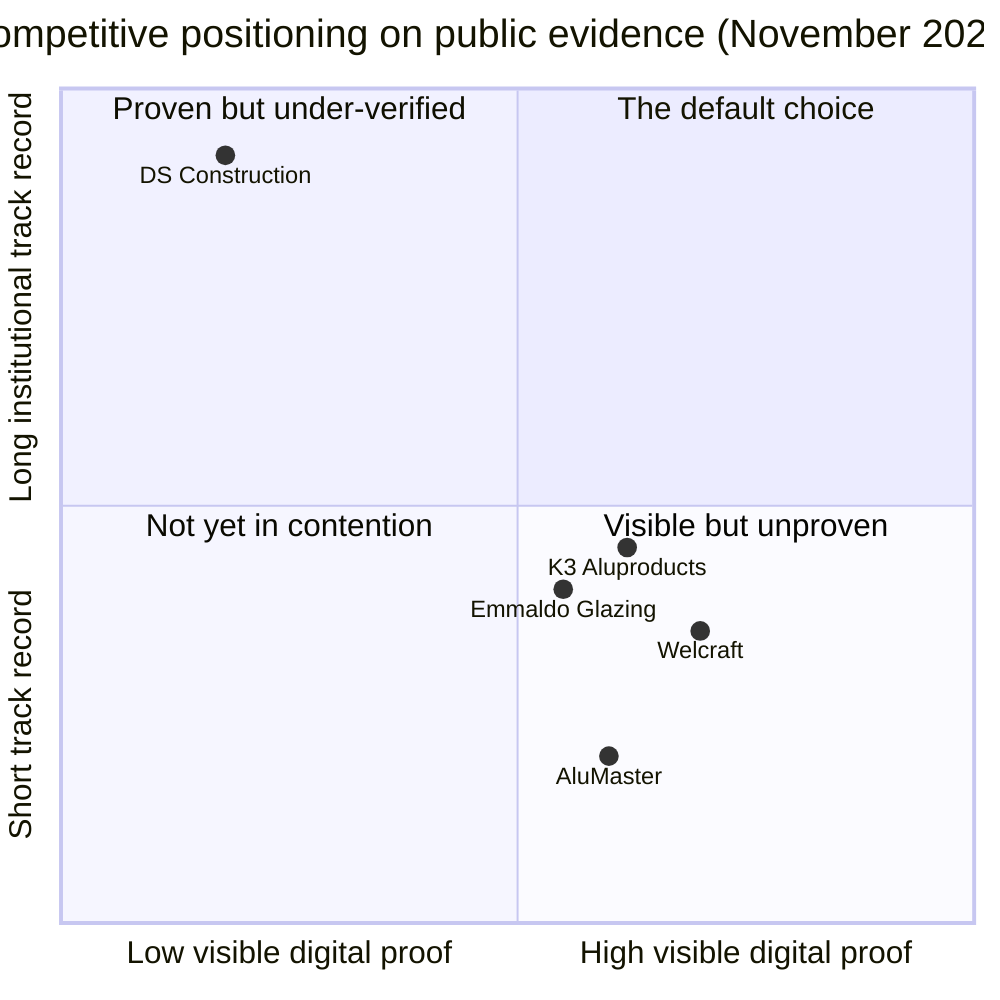

# Market & Digital Presence Audit — Summary
### DS Construction Limited · Prepared by Gideon B. Abochie (Gabochie Marketing / Gabochie Corp) · 6 November 2026

*This summary is yours to keep whether or not you proceed with the accompanying proposal. Full detailed audit shared after engagement begins.*

---

## 1. What the research covered

Desk research (November 2026) across: your full public web presence (current + archived website versions), your social profiles and directory listings, five direct competitors' public positioning, and Ghana construction-market data (Fitch Solutions, Ghana Statistical Service, Bank of Ghana, GlobalData 2026 releases).

## 2. Your standing assets (what the market cannot take from you)

1. **26 years** of continuous operation (est. 2000) — the longest institutional track record among surveyed glazing specialists
2. **In-house factory** with production lines — you design, manufacture and install; most rivals assemble or import
3. **Own fleet** — nationwide delivery plus Togo, without third-party logistics
4. **A blue-chip client list**: Ashesi University, University of Ghana, Toyota Ghana, GNAT, Ghana Employers' Association, Glenshire Hills Estate — including residential, corporate and government segments
5. **A recently rebuilt website** — a clean, modern shopfront; the team has already taken a real step forward

## 3. Where buyers cannot yet find or verify you (opportunity map)

| Gap | Why it matters |
|---|---|
| Little visible third-party proof (public reviews, client stories) | Ghanaian buyers now verify trust online before shortlisting |
| Limited search presence for high-intent searches ("aluminium windows Accra" etc.) | The tender's first filter is increasingly Google, not reputation heard on site |
| Enquiries handled conversationally rather than as a tracked pipeline | Industry-wide, 40–60% of quotes are never followed up — a system lifts win rates materially |
| New website's technical checks incomplete (tracking, search titles, enquiry-form delivery test) | Small fixes with outsized returns, achievable within weeks |
| No architect-facing technical materials | Specifiers choose contractors whose documentation commitment matches theirs |

## 4. Market timing (external data, 2026)

- Ghana construction output forecast **+5.2% growth in 2026**, ~+5.1% annually through 2030 (Fitch Solutions) — demand exists
- Near-term caution: cement sales −10.3% (Jan–Jul 2026, Bank of Ghana); building cost inflation 5.1% (Sept 2026, GSS) — visible, documented, responsive suppliers win the shorter pie
- Glazing was among the biggest drivers of construction cost inflation this year — an opening to sell energy efficiency and lifecycle value, not just price

*Demand is growing overall, but near-term caution rewards the supplier buyers can find and verify — exactly the gap this audit identifies.*

## 5. Competitive snapshot (public positioning only)

| Company | Their story | Your natural counter |
|---|---|---|
| K3 Aluproducts (est. 2014) | Italian-systems prestige, Airport City address | 26 years of Ghana-verified institutional proof |
| Emmaldo Glazing | International brand partnerships | In-house manufacture vs. distributor dependence |
| Welcraft (est. 2012) | Guarantees + benefit-led website | Factory complexity: "projects that scare other fabricators" |
| AluMaster | Affordability + live chat | Institutional-grade quality at scale |

None of these can copy your history or factory. None of them, yet, has built a strong public review base either — the first mover earns default trust.

### Positioning map — the empty top-right corner

*DS already owns the strongest track record in the market but sits in the "proven but under-verified" quadrant. No competitor yet occupies the top-right "default choice" position. The engagement's purpose is to move DS there first — before anyone else does.*

## 6. Conclusion

The gap between the company DS actually is and the company buyers can currently *see* is the single largest and most fixable value leak identified. Closing it does not require triumph over the market — it requires a system for visibility, proof and enquiry handling. The accompanying proposal sets out, milestone by milestone, how that system is built and how payment follows verified results.

*Detailed evidence, per-page findings and the complete 90-day plan are shared at kickoff.*
