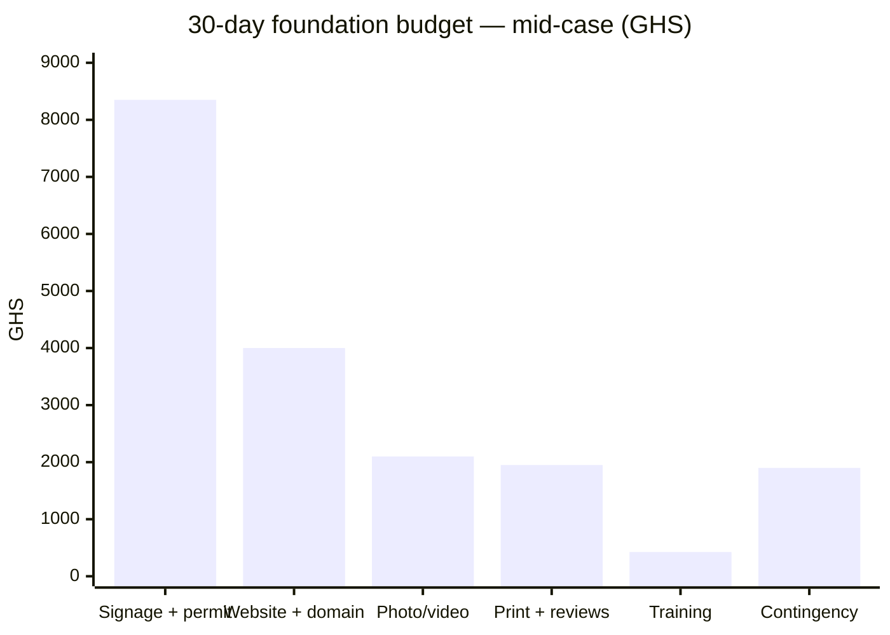
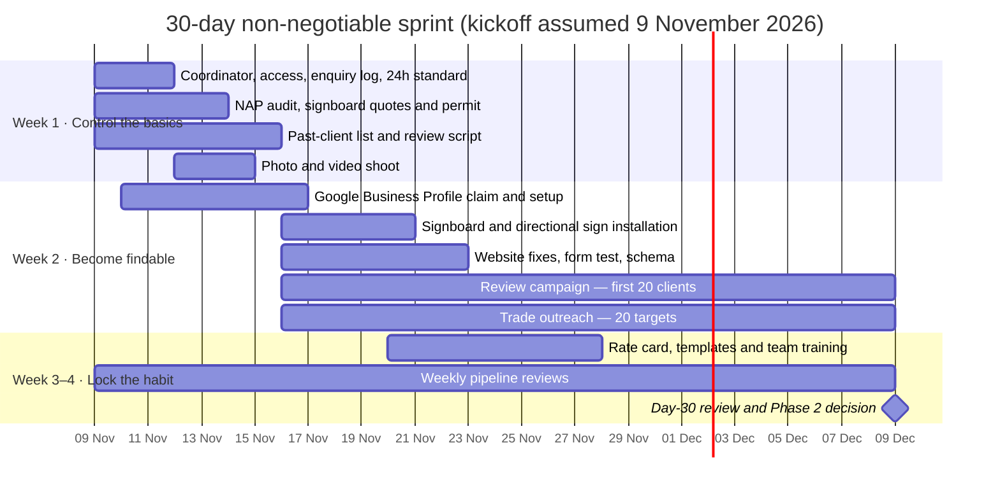

# 30-DAY NON-NEGOTIABLE FOUNDATIONS
**Immediate actions to make the DS Growth & Sales System executable**

**Client:** DS Construction Limited  
**Prepared by:** Gideon B. Abochie — Gabochie Marketing / Gabochie Corp  
**Date:** 6 November 2026  
**Window:** Day 1–30 from kickoff  
**Guiding rule:** No paid ads. No ad tracking. Organic, owned and referral channels only.  
**Reference:** mkt.gabochie.com

---

## 1. Why this annex exists

The 90-day plan in the proposal only works if the first 30 days are used to lay the foundations. This is the minimum operating condition for serious execution — not a wish list, and not a second proposal.

*This annex accompanies the digital-system options (A, B and C). If DS selects Option D — the Private Growth Partnership — the public-proof actions here still strengthen the same pipeline, but the private setup checklist in the proposal §9 governs the first two weeks (portfolio assets, target list, outreach scripts). No paid advertising is used in any option.*

Three things are true at the same time:

1. DS already has the strongest raw material in the market: 26 years, an in-house factory, a fleet, and blue-chip institutional work.
2. Buyers now verify before they shortlist — through Google, maps, reviews, and a working enquiry route.
3. The current foundations are incomplete: the Klagon showroom has no frontage signboard, public proof is thin, and enquiries are not yet tracked as a pipeline.

**What "non-negotiable" means here:** if any item in this annex slips by more than 48 hours, the Day-90 KPI sheet is at risk. The responsible person escalates to the MD the same day. Nothing on this list is optional, and nothing on it requires paid advertising.

---

## 2. The two meeting realities that shape this plan

### 2.1 No paid ads — the tax-tracking concern is respected

DS has said it avoids paid advertising because it does not want to be targeted and tracked by revenue authorities. We will respect that boundary completely.

**What we will NOT do in the first 30 days (or without written approval):**

- No Facebook, Instagram or Google ads
- No boosted posts
- No ad pixels, conversion tags or retargeting audiences
- No uploading customer lists or phone numbers to any ad platform
- No lookalike audiences built from DS customers

**What we will do instead:** build the free, owned and referral channels that do not depend on ad platforms — Google Business Profile, search-friendly pages, real reviews, WhatsApp, trade outreach, signage and referrals. These are the foundations that make any future paid media work; they are also the foundations that work without it.

This is not tax advice. It is an operating boundary. Revenue and customer records remain inside DS's own systems. If DS ever wants to test paid media, it will be after Day 90, with written approval, and without customer-list uploads or pixel-based retargeting.

### 2.2 The Klagon showroom has no frontage signboard

A signboard is not a magic Google ranking button, but its absence weakens every foundation we are trying to build:

- Buyers arriving from Google Maps cannot immediately confirm they are in the right place.
- Google Business Profile verification, photo authenticity and prominence signals are weaker.
- The showroom cannot convert walk-ins it never identifies.
- The 26-year brand looks less established than it is at the exact moment of first contact.

**Non-negotiable:** obtain two quotes by Day 5 and install by Day 20. The sign must carry the exact business name, logo, phone number, `mkt.gabochie.com`, and opening hours. Add a QR code to the Google review link and a directional sign at the road entrance. Photograph the finished frontage from three angles and upload the photos to Google Business Profile the same week.

---

## 3. The 30 non-negotiable actions

### Week 1 (Days 1–7) — Control the basics

| # | Action | Owner | Deadline | Evidence of done | Direct cost (GHS) |
|---|---|---|---|---|---|
| 1 | Appoint a named **Sales Coordinator** (existing staff is ideal) and protect 45 minutes/day | MD | Day 2 | Name and written role note | 0 |
| 2 | Hand over access: domain, hosting, website admin, Google Business Profile, Facebook, Instagram, WhatsApp Business, email | MD / IT | Day 2 | Signed access checklist | 0 |
| 3 | Switch on one **enquiry log** (Google Sheet or free CRM) and log every enquiry the same day | Coordinator | Day 1 | First 5 enquiries logged | 0 |
| 4 | Adopt the **24-hour response standard** and WhatsApp auto-reply | MD + Coordinator | Day 1 | Auto-reply live; standard posted | 0 |
| 5 | Audit and correct **NAP** (name, address, phone, hours, website) across Google, Facebook, Instagram and directories | Consultant + Coordinator | Day 5 | NAP sheet and screenshots | 0 |
| 6 | Get two quotes and **order the Klagon frontage signboard** | MD | Day 5 | Signed quote / order | 4,500–9,000 |
| 7 | Apply for or confirm the **signage permit** with the local assembly | MD | Day 5 | Application / receipt | 300–1,200 |
| 8 | Book the **photo and video shoot** (showroom, factory, team, three projects) | Coordinator | Day 7 | Booking confirmation | 1,200–3,000 |
| 9 | Compile the **past-client list** — minimum 40 names and numbers for reviews and case studies | MD + Coordinator | Day 7 | List in the CRM | 0 |
| 10 | Approve the **review-request script** and the approval workflow | MD | Day 7 | Signed script | 0 |

### Week 2 (Days 8–14) — Become findable and verifiable

| # | Action | Owner | Deadline | Evidence of done | Direct cost (GHS) |
|---|---|---|---|---|---|
| 11 | Claim and verify **Google Business Profile**; set primary category (aluminium window supplier / window installation service), service areas, hours, services, products, opening date (2000) | Consultant | Day 10 | Live, verified profile | 0 |
| 12 | Upload **20+ real photos**, logo, cover image and a 30-second showroom video | Coordinator + Consultant | Day 14 | Photo count on profile | 0 |
| 13 | Install the **signboard**, directional sign and QR review decal | Vendor / MD | Day 20 target Day 14 | Installation photos | 500–1,200 (directional) |
| 14 | Publish the **Google review link and QR cards**; begin asking the first 20 past clients | Coordinator | Day 10 start | WhatsApp log and review count | 300–700 |
| 15 | Fix the **website enquiry form** end-to-end; add WhatsApp click-to-chat, click-to-call and a Klagon showroom map/directions page | Web developer + Consultant | Day 14 | Test submission and live URL | 1,500–4,500 |
| 16 | Add **local business schema** and correct titles/descriptions for the top 5 pages | Web developer + Consultant | Day 14 | Live URLs and test result | included in #15 |
| 17 | Confirm **ownership** of domain, hosting, WhatsApp line and social accounts (in DS's name, not a vendor's) | MD + Consultant | Day 14 | Ownership checklist | 0 (renewals 500–1,500 if due) |
| 18 | Publish **2 project stories** with photos, scope, location and outcome (no confidential pricing) | Consultant + Coordinator | Day 21 | Live URLs | 0 |
| 19 | Build the **20-target trade list** (architects, QS firms, developers, estate managers) and start a three-touch cadence | MD + Coordinator | Day 14 list; ongoing | Outreach log | 0 |
| 20 | Start the **weekly 30-minute pipeline review** and the five-line dashboard | MD | Day 7 first meeting; weekly | Meeting notes and dashboard | 0 |

### Week 3 (Days 15–21) — Make the system run

| # | Action | Owner | Deadline | Evidence of done | Direct cost (GHS) |
|---|---|---|---|---|---|
| 21 | Approve the **rate card** and three package offers (Estate Bundle, Fit-Out Package, Home Upgrade) | MD | Day 20 | Signed rate card | 0 |
| 22 | Put the **four templates** into daily use: survey form, quote/BOQ, rate card, deposit-and-milestones contract | Coordinator | Day 21 | First 3 quotes issued from templates | 0 |
| 23 | Run the **two-hour team training**: 24-hour response, WhatsApp scripts, enquiry log, review requests, quote handoff | Consultant | Day 20 | Attendance sheet | 250–600 |
| 24 | Install **privacy-friendly analytics** or rely on Google Business Profile insights only; **no ad pixels** | Web developer + Consultant | Day 21 | Dashboard access | 0–250/month |
| 25 | Reach **15 Google reviews** (the Day-30 target; 25 by Day 90) and reply to every review within 48 hours | Coordinator | Day 30 | Profile review count | 0 |
| 26 | Publish **8–10 Google posts** and at least 3 social posts per week | Coordinator | Ongoing | Post log | 0 |

### Week 4 (Days 22–30) — Lock the habit

| # | Action | Owner | Deadline | Evidence of done | Direct cost (GHS) |
|---|---|---|---|---|---|
| 27 | Hold the first **numbers review**: enquiries, quotes, wins, losses, response time | MD + Consultant | Day 28 | Dashboard screenshot | 0 |
| 28 | Fix the blockers found in the review and confirm the **Day-60 targets** | MD + Consultant | Day 30 | Signed review note | 0 |
| 29 | Assemble the **evidence pack**: signboard photos, GBP live, reviews, form test, templates, dashboard | Consultant | Day 30 | Evidence pack | 0 |
| 30 | Decide and sign the **Phase 2 go-ahead** (Days 31–90) | MD | Day 30 | Signed go-ahead | 0 |

---

## 4. What it costs

These are DS's **direct operating costs** — not the consultant's fee. All figures are indicative Greater Accra ranges as of November 2026. Obtain two local quotes for the signboard and website work; the plan proceeds with the lower compliant quote.

### 4.1 Non-negotiable minimum (one-time)

| Item | Low (GHS) | High (GHS) | Notes |
|---|---:|---:|---|
| Klagon frontage signboard, installed | 4,500 | 9,000 | Illuminated only if the lower quote allows; non-illuminated is acceptable |
| Signage permit / assembly fee | 300 | 1,200 | Confirm at the local assembly |
| Directional sign and QR review decal | 500 | 1,200 | Road entrance plus showroom door |
| Print kit: review cards, rate cards, survey forms, quote books, vehicle stickers | 900 | 2,000 | Use DS's existing printer where possible |
| Website fixes (form, WhatsApp, schema, showroom page) | 1,500 | 4,500 | Brief supplied by the consultant |
| Domain / hosting / SSL renewal (if due) | 500 | 1,500 | Must be registered in DS's name |
| Training refreshments and printing | 250 | 600 | Two-hour session |
| **Subtotal** | **8,450** | **20,000** |  |
| Contingency (10%) | 845 | 2,000 | Signage and permit variability |
| **NON-NEGOTIABLE TOTAL** | **9,300** | **22,000** | **Paid by DS; no ad spend** |

### 4.2 Strongly recommended (not blocking, but improves speed)

| Item | Low (GHS) | High (GHS) | Notes |
|---|---:|---:|---|
| Professional photo/video shoot | 1,200 | 3,000 | A phone shoot at GHS 0 is acceptable if the coordinator is coached |
| Review thank-you cards (no paid reviews) | 300 | 700 | Policy-compliant thank-you only |
| Privacy-friendly analytics | 0 | 250 / month | Or use Google Business Profile insights only |
| Coordinator airtime, data and transport | 400 | 800 / month | If not already covered by DS |

### 4.3 30-day cash view

| Category | Low (GHS) | High (GHS) |
|---|---:|---:|
| Direct one-time costs (all items above) | 10,800 | 25,700 |
| Monthly recurring costs | 400 | 1,050 |
| Paid advertising | **0** | **0** |
| Consultant Foundation fee (Option B, proposal §5) | 40,000 | 40,000 |

**The foundation budget is roughly GHS 10,800–25,700 once, plus GHS 400–1,050/month. Paid ads are zero.** The consultant fee is separate and already set out in the proposal; it is not part of this operating budget.

---

## 5. The 30-day timeline

---

## 6. What DS must provide (the non-negotiable inputs)

1. **A named Sales Coordinator** by Day 2 — an existing staff member is ideal; the consultant trains them.
2. **Access** to domain, hosting, website, Google Business Profile, social accounts and WhatsApp by Day 2.
3. **The past-client list** — at least 40 names and numbers — by Day 7.
4. **Signboard approval** and two quotes by Day 5; installation by Day 20.
5. **Website developer availability** by Day 7; if unavailable, written authorisation for the consultant to implement directly.
6. **Rate card approval** by Day 20.
7. **30 minutes per week** from the MD for the pipeline review.
8. **Written confirmation** of the no-paid-ads boundary for the first 30 days.

---

## 7. What the consultant delivers in the 30 days

- A short audit recap and the prioritised fix list
- The website brief (form, WhatsApp, schema, showroom page, titles)
- The NAP consistency sheet and Google Business Profile setup
- The review-request scripts, QR cards and approval workflow
- The rate card and four sales templates
- The enquiry log, dashboard and weekly review cadence
- The two-hour team training
- The Day-30 evidence pack and Phase 2 go-ahead

This work is covered by the Option B Foundation fee in the proposal (§5). The direct costs in §4 are DS's own operating costs.

---

## 8. The do-not-do list

1. **No paid ads, boosted posts, ad pixels or customer-list uploads** in the first 30 days.
2. **No fake reviews, bought followers or review incentives** that breach Google policy.
3. **No vendor-owned accounts** — domain, hosting, WhatsApp line and social pages must be in DS's name.
4. **No WhatsApp-only quotes** — every enquiry goes into the log, even if it closes on the phone.
5. **No quoting without the rate card** after Day 20.
6. **No stock photos** on Google Business Profile — real premises, real team, real projects only.
7. **No "top ranking" promises** — the target is consistent visibility, verifiable proof and a working pipeline.

---

## 9. Definition of done by Day 30

- [ ] Sales Coordinator named, trained and working 45 minutes/day
- [ ] Enquiry log live; every new enquiry logged; 24-hour response standard in use
- [ ] Google Business Profile verified with 20+ real photos, correct NAP, hours, services, products and showroom directions
- [ ] Klagon frontage signboard installed, plus directional sign and QR review decal
- [ ] 15+ Google reviews (target), every review answered within 48 hours
- [ ] Website enquiry form tested end-to-end; WhatsApp click-to-chat, local schema and top-5 page titles live
- [ ] Rate card and four templates in daily use; first three quotes issued from templates
- [ ] 40-name past-client list and 20 trade targets contacted
- [ ] Weekly dashboard running four consecutive weeks
- [ ] No paid ads and no ad tracking installed
- [ ] Day-30 review signed; Phase 2 go-ahead decided

---

## 10. Risks and mitigations

| Risk | Mitigation |
|---|---|
| Signage permit delays installation | Apply on Day 5; use a compliant temporary banner only if the assembly allows it; keep photo evidence of the process |
| Client discomfort asking for reviews | Consultant supplies scripts and runs the first 20 requests with the coordinator; MD approves every public quote |
| Website developer is slow or unavailable | Exact brief supplied by Day 7; written authorisation to implement directly if the developer misses the date |
| Tax/tracking concern resurfaces | Organic-only plan; no pixels; no customer-list uploads; records stay in DS's systems; paid media deferred to Day 90+ with written consent |
| Showroom access or photo quality | Book the shoot by Day 7; a coached phone shoot is acceptable; no stock images |
| Staff bandwidth | 45 minutes/day for one coordinator, 30 minutes/week for the MD; no additional meetings |

---

## 11. Sign-off

By signing, DS confirms the 30 actions, the named owners and the direct budget in §4. The consultant confirms delivery of the items listed in §7. The Day-90 KPI sheet in the proposal remains the basis for Parts 2 and 3 of the fee.

| For DS Construction Limited | For the Consultant |
|---|---|
| Name: ______________________ | Name: Gideon B. Abochie |
| Title: ______________________ | Title: Principal, Gabochie Marketing |
| Signature: __________________ | Signature: __________________ |
| Date: ______________________ | Date: ______________________ |
